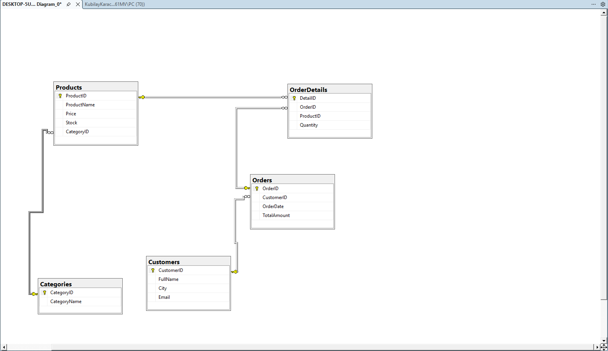

# 🛒 NovaStore E-Ticaret Veri Yönetim Sistemi


Bir e-ticaret şirketinin kategori, ürün, müşteri ve sipariş verilerini yönetmek için **Microsoft SQL Server** üzerinde tasarlanmış ilişkisel bir veri tabanı projesi.

Proje; veri tabanı tasarımını (DDL), örnek veri girişini (DML), JOIN ve aggregate fonksiyonlarıyla yapılan analiz sorgularını (DQL), görünüm (VIEW) oluşturmayı ve veri tabanı yedeklemeyi uçtan uca kapsar.

---

## 📑 İçindekiler
- [Özellikler](#-özellikler)
- [Kullanılan Teknolojiler](#-kullanılan-teknolojiler)
- [Dosya Yapısı](#-dosya-yapısı)
- [Veri Tabanı Tasarımı](#-veri-tabanı-tasarımı)
- [Örnek Veri Seti](#-örnek-veri-seti)
- [Sorgular ve Analizler](#-sorgular-ve-analizler)
- [Görünüm ve Yedekleme](#-görünüm-ve-yedekleme)
- [Kurulum ve Çalıştırma](#-kurulum-ve-çalıştırma)

---

## 🚀 Özellikler
- **İlişkisel Tasarım:** Beş tablodan oluşan, Primary Key ve Foreign Key ilişkileriyle bağlanmış normalleştirilmiş veri modeli.
- **Veri Bütünlüğü:** `PRIMARY KEY`, `FOREIGN KEY`, `UNIQUE`, `NOT NULL` ve `DEFAULT` kısıtları ile tutarlı veri girişi.
- **Otomatik Kimlik:** Tüm tablolarda `IDENTITY(1,1)` ile otomatik artan birincil anahtarlar.
- **Analiz Sorguları:** `INNER JOIN`, `LEFT JOIN`, çoklu JOIN, `GROUP BY`, `COUNT`, `SUM` ve `DATEDIFF` ile raporlama.
- **Görünüm (VIEW):** Sipariş özetini tek sorguda sunan `vw_SiparisOzet` görünümü.
- **Yedekleme:** `BACKUP DATABASE` komutu ile veri tabanının `.bak` dosyasına yedeklenmesi.

---

## 🛠 Kullanılan Teknolojiler
- **Veri Tabanı Yönetim Sistemi:** Microsoft SQL Server
- **Sorgu Dili:** T-SQL (Transact-SQL)
- **Geliştirme Ortamı:** SQL Server Management Studio (SSMS)

---

## 📁 Dosya Yapısı

```text
novastore-sql/
├── KubilayKaraca_NovaStore_Proje.sql    # Tüm SQL kodları (DDL, DML, DQL, VIEW, BACKUP)
├── KubilayKaraca_NovaStore_Proje.docx   # Kodların ve sorgu sonuçlarının açıklandığı proje raporu
├── KubilayKaraca_NovaStore_Proje.png    # Tabloların ilişkisel yapısını gösteren veri tabanı diyagramı
└── README.md                            # Proje dokümantasyonu
```

---

## 🗄 Veri Tabanı Tasarımı

Veri tabanının adı **`NovaStoreDB`**'dir. Foreign Key bağımlılıkları nedeniyle önce ana tablolar (`Categories`, `Customers`), ardından bağımlı tablolar (`Products`, `Orders`, `OrderDetails`) oluşturulmuştur.

### Tablolar

| Tablo | Açıklama | Alanlar |
| :--- | :--- | :--- |
| **Categories** | Ürün kategorileri | `CategoryID` (PK), `CategoryName` (NOT NULL) |
| **Customers** | Müşteri bilgileri | `CustomerID` (PK), `FullName`, `City`, `Email` (UNIQUE) |
| **Products** | Ürünler | `ProductID` (PK), `ProductName` (NOT NULL), `Price`, `Stock` (DEFAULT 0), `CategoryID` (FK) |
| **Orders** | Siparişler | `OrderID` (PK), `CustomerID` (FK), `OrderDate` (DEFAULT GETDATE()), `TotalAmount` |
| **OrderDetails** | Sipariş–ürün ara tablosu | `DetailID` (PK), `OrderID` (FK), `ProductID` (FK), `Quantity` |

### İlişkiler

| İlişki | Tür |
| :--- | :--- |
| Categories → Products | Bir kategoride birden çok ürün bulunabilir (1 - N) |
| Customers → Orders | Bir müşteri birden çok sipariş verebilir (1 - N) |
| Orders → OrderDetails | Bir sipariş birden çok ürün satırı içerebilir (1 - N) |
| Products → OrderDetails | Bir ürün birden çok siparişte yer alabilir (1 - N) |

### Veri Tabanı Diyagramı



---

## 📦 Örnek Veri Seti

| Tablo | Kayıt Sayısı | İçerik |
| :--- | :---: | :--- |
| Categories | 5 | Elektronik, Giyim, Kitap, Kozmetik, Ev ve Yaşam |
| Products | 12 | Her kategoriye ait ürünler (fiyat ve stok bilgisiyle) |
| Customers | 5 | Farklı şehirlerden müşteriler |
| Orders | 8 | Farklı tarihlerde verilmiş siparişler |
| OrderDetails | 10 | Siparişlere ait ürün satırları |

Her siparişin toplam tutarı (`TotalAmount`), o siparişe ait ürünlerin fiyatları toplamına eşit olacak şekilde girilmiştir.

---

## 🔍 Sorgular ve Analizler

| # | Analiz | Kullanılan Yapılar |
| :---: | :--- | :--- |
| 1 | Stok miktarı 20'den az olan ürünler (stoka göre azalan sırada) | `WHERE`, `ORDER BY ... DESC` |
| 2 | Hangi müşteri hangi tarihte sipariş vermiş? (ad, şehir, tarih, tutar) | `INNER JOIN` |
| 3 | "Ahmet Yılmaz" isimli müşterinin aldığı ürünler, fiyatları ve kategorileri | 4 tabloyu birleştiren çoklu `JOIN` |
| 4 | Her kategoride toplam kaç ürün olduğu | `LEFT JOIN`, `GROUP BY`, `COUNT()` |
| 5 | Her müşterinin şirkete kazandırdığı toplam ciro (yüksekten düşüğe) | `JOIN`, `GROUP BY`, `SUM()`, `ORDER BY` |
| 6 | Siparişlerin üzerinden bugüne kadar kaç gün geçtiği | `DATEDIFF()`, `GETDATE()` |

**Örnek (Ciro Analizi):**

```sql
SELECT c.FullName AS 'Müşteri Adı', SUM(o.TotalAmount) AS 'Toplam Ciro'
FROM Customers c
JOIN Orders o ON c.CustomerID = o.CustomerID
GROUP BY c.FullName
ORDER BY SUM(o.TotalAmount) DESC;
```

Tüm sorgular ve sonuçlarının ekran görüntüleri `KubilayKaraca_NovaStore_Proje.docx` raporunda yer almaktadır.

---

## 🧩 Görünüm ve Yedekleme

### Görünüm (VIEW): `vw_SiparisOzet`
Müşteri adı, sipariş tarihi, ürün adı ve adet bilgilerini dört tabloyu birleştirerek tek bir sanal tabloda sunar.

```sql
SELECT * FROM vw_SiparisOzet;
```

> `CREATE VIEW` komutu bulunduğu batch'in ilk komutu olmak zorunda olduğu için önceki sorgulardan `GO` ile ayrılmıştır.

### Yedekleme (Backup)
Veri tabanının tam yedeği `C:\Yedek\NovaStoreDB.bak` dosyasına alınır.

```sql
BACKUP DATABASE NovaStoreDB
TO DISK = 'C:\Yedek\NovaStoreDB.bak';
```

---

## ⚙️ Kurulum ve Çalıştırma

### Ön Koşullar
- Microsoft SQL Server (Express veya Developer sürümü yeterlidir)
- SQL Server Management Studio (SSMS)

### Adımlar

1. **Projeyi indirin:**
   ```bash
   git clone https://github.com/KubilayKaraca/novastore-sql.git
   ```

2. **Yedekleme klasörünü oluşturun:**
   Betiğin son adımındaki yedekleme komutunun çalışabilmesi için bilgisayarınızda `C:\Yedek` klasörünü oluşturun.

3. **Betiği açın:**
   SSMS ile SQL Server'a bağlanın ve `KubilayKaraca_NovaStore_Proje.sql` dosyasını açın.

4. **Çalıştırın:**
   `Execute` (F5) ile betiği çalıştırın. Betik sırasıyla veri tabanını ve tabloları oluşturur, örnek verileri ekler, analiz sorgularını çalıştırır, `vw_SiparisOzet` görünümünü oluşturur ve yedeği alır.

> **Not:** Betik `NovaStoreDB` veri tabanını sıfırdan oluşturur. Aynı isimde bir veri tabanı zaten varsa, betiği çalıştırmadan önce onu silmeniz veya yeniden adlandırmanız gerekir.

---

## 👤 Hazırlayan

**Kubilay Karaca**
GitHub: [@KubilayKaraca](https://github.com/KubilayKaraca)

---
*Bu proje, TNC Group yazılım stajı kapsamında Veri Tabanı ve SQL projesi olarak geliştirilmiştir.*
